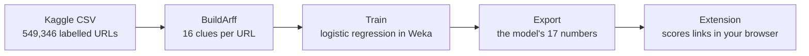

```
███████╗ █████╗ ██╗   ██╗██╗   ██╗ █████╗ ██████╗ 
██╔════╝██╔══██╗╚██╗ ██╔╝╚██╗ ██╔╝██╔══██╗██╔══██╗
███████╗███████║ ╚████╔╝  ╚████╔╝ ███████║██║  ██║
╚════██║██╔══██║  ╚██╔╝    ╚██╔╝  ██╔══██║██║  ██║
███████║██║  ██║   ██║      ██║   ██║  ██║██████╔╝
╚══════╝╚═╝  ╚═╝   ╚═╝      ╚═╝   ╚═╝  ╚═╝╚═════╝ 
    ><(((('>  hunting phishing links  <'))))><
```

# Sayyad (صيّاد)


**A Chrome extension that warns you about phishing links before you click.** It runs its own machine learning model right inside your browser, so nothing is ever sent to a server.

*Sayyad* means "the fisherman" in Arabic: phishers fish for passwords, and Sayyad catches their links.

## Demo

<p align="center">
  <a href="https://www.youtube.com/watch?v=JbLUng9pQCk">
    
  </a>
</p>

<p align="center">
  <a href="https://www.youtube.com/watch?v=JbLUng9pQCk"><b>▶ Watch the demo on YouTube</b></a><br>
  <sub>What phishing is and how it happens, then Sayyad catching it live, with its test results.</sub>
</p>

## What it does

- **Marks risky links.** Links that look like phishing get a red outline, and hovering over one tells you why.
- **Warns you on risky pages.** If the page you're on looks like phishing, a red banner shows the score and the reasons.
- **Knows Saudi brands.** It catches fakes of local services, like a link that mentions Absher but isn't on `absher.sa`.
- **Stays quiet on real sites.** It never flags well-known sites, or any `.gov.sa` or `.edu.sa` site.
- **Keeps your browsing private.** Every check happens on your own device.

## How it works

Sayyad judges a link by its address alone, without opening it, in three steps:

1. **Read the clues.** The address becomes 16 numbers, one per clue: its length, whether it uses an IP address instead of a name, an `@` sign, scam words, a cheap ending like `.xyz`, a link shortener, and more.
2. **Score it.** A logistic regression model weighs the clues and turns them into a phishing score between 0 and 100%.
3. **Decide.** The score is combined with two extra rules:

```
warn = (score ≥ 90%  OR  fake Saudi brand)  AND NOT  on the trusted list
```

### The model

The model was trained in Java with Weka on a public Kaggle dataset of 549,346 labelled web addresses. Logistic regression keeps the whole model to 17 numbers, a weight for each of the 16 clues plus one bias, so it fits inside the extension and scores every link on a page instantly.



The extension computes the same 16 clues in JavaScript and applies the exported numbers to them.

## Results

Tested on 45,718 links the model never saw during training:

| Precision | False alarms | Recall |
|:---:|:---:|:---:|
| **98.3%** | **0.5%** | **26%** |

- **Precision:** when the model flags a link, it's right about 98 times out of 100.
- **False alarms:** only about 1 in 200 real links gets flagged.
- **Recall:** the model alone catches about a quarter of phishing links.

The high threshold is what keeps false alarms rare, because a warning that shows up on real sites every day is one people learn to ignore. The cost is lower recall, and the Saudi brand rule catches lookalikes on top of what the model finds.

On the test page (`tests/links.html`), all 11 fake links were caught and none of the 11 real sites were flagged.

## Install

1. Download this repo (**Code → Download ZIP**) and unzip it.
2. Open `chrome://extensions` and turn on **Developer mode**.
3. Click **Load unpacked** and choose the `extension` folder.

Using Microsoft Edge? Open `edge://extensions` instead. The steps are the same.

## Project structure

```
extension/          the browser extension (the folder you load)
trainer/            Java + Weka code: BuildArff → Train → Export
tests/links.html    test page with 11 fake and 11 real links
```

## Retraining the model

Put `weka.jar` and the Kaggle CSV in `trainer/`, then run:

```
cd trainer
javac -cp weka.jar *.java
java -cp ".;weka.jar" BuildArff
java -Xmx4g -cp ".;weka.jar" Train
java -cp ".;weka.jar" Export
```

On macOS or Linux, write the classpath with `:` instead of `;` (`".:weka.jar"`).

## Limitations

- **It reads only the address.** It never looks at the page itself, so a phishing page behind a clean-looking address can get through.
- **It misses most phishing links on its own.** It's tuned to avoid false alarms, so treat it as a second pair of eyes, not a replacement for caution.
- **The data is old.** The model was trained on an older, global public dataset, and phishing tricks keep changing.
- **The Saudi brand list is hand-made**, so it only knows the brands on it.
- **It warns but never blocks.** You always decide whether to open a link.

## What's next

Sayyad only reads the address for now. Next, I want it to check more than just the address.

## بالعربي

<div dir="rtl">

**صيّاد** إضافة لمتصفح كروم تنبّهك إلى روابط التصيّد الاحتيالي قبل أن تضغط عليها. تعتمد على نموذج تعلّم آلي درّبتُه بلغة Java باستخدام Weka، وتعمل بالكامل داخل متصفحك، فلا يُرسَل أي رابط إلى أي خادم.

- تحيط الروابط الخطرة بإطار أحمر، وتوضّح سبب التحذير عند تمرير المؤشر عليها.
- تُظهر شريط تحذير أحمر إذا بدت الصفحة التي تزورها احتيالية.
- تكشف الروابط التي تنتحل جهات سعودية، مثل رابط يذكر أبشر وهو ليس على `absher.sa`.
- لا تنبّه أبدًا على المواقع المعروفة، ولا على أي موقع ينتهي بـ `.gov.sa` أو `.edu.sa`.

المحتالون يتصيّدون كلمات المرور، وصيّاد يصطاد روابطهم.

</div>

## Credits

Built by Ahmed Alharbi, using Weka from the University of Waikato and a public Kaggle dataset of phishing and legitimate URLs.
